# nodesec - Cross-platform System & Network Security Platform

Cross-platform system and network security platform combining system security auditing with real-time network threat detection. Written in Rust for performance, type safety, and cross-platform support.

## Features

### Core System Security Auditing
- **Cross-platform**: Linux (x86_64, aarch64), macOS (x86_64, arm64), Windows (x86_64)
- **Security checks** (27 total):
  - Linux: Firewall (ufw/firewalld/nftables), SSH (root login, password auth), Auto-updates (unattended-upgrades/dnf-automatic)
  - macOS: Firewall, FileVault, Remote Login, Auto-updates
  - Windows: Firewall profiles, BitLocker, Remote Desktop, Defender real-time, Driver signing
- **CVE enrichment**: NIST NVD API 2.0 integration with CVSS scoring & EPSS
- **Application inventory**: dpkg/rpm/pacman/brew/Windows Registry + CPE matching
- **Process assessment**: Suspicious process detection (temp dirs, injection signs, known tool names)
- **Remediation scripts**: Platform-specific (bash/PowerShell) with safety guards
- **Multiple outputs**: Text, JSON, CSV
- **Three interfaces**: CLI, TUI (ratatui/crossterm), GUI (Tauri + React/D3.js)
- **Compliance mapping**: ISO27001, HIPAA, PCI-DSS
- **Desktop report export**: Automatic bundle to ~/Desktop

### Network Threat Detection
- **Real-time connection monitoring**: Cross-platform network monitoring
  - Linux: `/proc/net/tcp` + netlink sockets + eBPF (CO-RE)
  - macOS: libproc + NetworkExtension framework
  - Windows: GetExtendedTcpTable + ETW (Event Tracing for Windows)
- **Advanced Threat Detection**: Rule-based analysis of network connections for suspicious patterns
- **Interactive Visualization**: D3.js-based force-directed graph with threat indicators
- **Process Details**: Deep dive into process information and connection history
- **Unusual Destinations**: Flags connections to rare or unknown IPs
- **High Frequency Monitoring**: Detects connection bursts and port scanning
- **Suspicious Port Detection**: Identifies connections to non-standard ports
- **Timing Analysis**: Flags connections during unusual hours
- **Process Anomalies**: Detects hidden executables and suspicious processes
- **Geographic Analysis**: Identifies connections from unusual geographic regions (GeoIP)
- **Force-Directed Graph**: Interactive network topology with clustering
- **Threat-Based Coloring**: Blue (safe) → Yellow (warning) → Red (suspicious) → Purple (critical)
- **Real-time Updates**: Live streaming of new connections via WebSocket
- **Zoom & Pan**: Navigate complex network visualizations
- **Process Selection**: Click nodes for detailed analysis
- **Connection Highlighting**: Visual pathways for threat chains
- **Process Control**: Kill suspicious processes from GUI

### Parent-Child Mode (SIEM-like)
- **Centralized Server**: Aggregates data from multiple client nodes
- **Encrypted Communication**: TLS + custom public/private key encryption
- **Client Agent**: Lightweight monitor running on endpoints
- **Real-time Alerting**: Server pushes alerts to connected clients
- **Historical Analysis**: Query past events from centralized store

### Net-Installer (nodesec-installer)
- **Cross-platform**: Single binary works on Linux, macOS, Windows
- **Multiple install modes**: Pre-built binary (default) or `--from-source`
- **Version pinning**: `--version` to install specific releases
- **Target selection**: `--target user|system` (user=~/.local/bin, system=/usr/local/bin or C:\Program Files\nodesec)
- **Auto-dependencies**: apt/dnf/pacman/brew/winget/choco/scoop
- **Shortcut creation**: .desktop (Linux), symlink (macOS), Start Menu (Windows)
- **PATH management**: Auto-adds to shell rc files / Windows user PATH
- **Uninstall**: `--uninstall` removes binaries, shortcuts, PATH entries

## How It Works

```mermaid
flowchart TD
    A["User runs nodesec"] --> B{"Mode Selection"}
    B -->|"nodesec net live"| C["On-Device Network Monitoring"]
    B -->|"nodesec net server"| D["SIEM WebSocket Server"]
    B -->|"nodesec net agents"| E["Manage Endpoint Agents"]
    B -->|"nodesec audit run"| F["Static Security Audit"]
    B -->|"nodesec report"| G["View Reports"]

    C --> C1["Detect Platform\nLinux/macOS/Windows"]
    C1 --> C2["Start NetworkMonitor\n/proc, netstat, ETW"]
    C2 --> C3["Scan Connections\nEvery 2s interval"]
    C3 --> C4["ThreatDetector Analysis\nRules + ML Scoring"]
    C4 --> C5["Real-time TUI/GUI\nLive Connections Table"]
    C5 --> C6["User Action\nPause/Filter/Export"]

    D --> D1["Start axum WebSocket\n0.0.0.0:8080"]
    D1 --> D2["Accept Agent Connections"]
    D2 --> D3["Aggregate Connections\n+ Threat Alerts"]
    D3 --> D4["Distribute Rules\nto Agents"]
    D4 --> D5["Dashboard: Agents\n+ Centralized Alerts"]

    E --> E1["Register/Revoke\nAgent Access"]
    E1 --> E2["Agent Heartbeat\n+ Status Monitor"]

    F --> F1["Detect Target OS\nor --target-os"]
    F1 --> F2["Load 27 Security Rules\nPlatform-specific"]
    F2 --> F3["Run Configuration Checks"]
    F3 --> F4{"--include-cves?"}
    F4 -->|Yes| F5["Query NIST NVD API 2.0\nCVSS + EPSS"]
    F4 -->|No| F6["Skip CVE Enrichment"]
    F5 --> F7{"--scan-apps?"}
    F6 --> F7
    F7 -->|Yes| F8["Inventory Apps\n+ CPE Matching"]
    F7 -->|No| F9{"--collect-logs?"}
    F8 --> F9
    F9 -->|Yes| F10["Collect System Logs\njournalctl/EventLog"]
    F9 -->|No| F11{"--scan-ad?"}
    F10 --> F11
    F11 -->|Yes| F12["AD Security Scan\nLDAP/SMB/SSSD"]
    F11 -->|No| F13{"--generate-remediation?"}
    F12 --> F13
    F13 -->|Yes| F14["Write bash/PowerShell\nRemediation Script"]
    F13 -->|No| F15["Render Report\nText/JSON/CSV"]
    F14 --> F15
    F15 --> F16["Export to Desktop\nnodesec-{platform}-{timestamp}/"]

    G --> G1["List/View/Export\nReports"]
    G1 --> G2["Format: Text/JSON/CSV"]

    %% Installer Flow
    H["curl install.sh | bash"] --> H1["Detect Platform\n+ Package Manager"]
    H1 --> H2["Download Binary\nor Build from Source"]
    H2 --> H3["Install to ~/.local/bin\nor /usr/local/bin"]
    H3 --> H4["Add to PATH\n+ Create Shortcuts"]
    H4 --> I["nodesec ready to run"]

    style A fill:#0d252f,stroke:#22d3ee,stroke-width:2px
    style B fill:#0d252f,stroke:#22d3ee,stroke-width:2px
    style C fill:#0f1b2a,stroke:#fbbf24,stroke-width:1px,stroke-dasharray: 4 4
    style D fill:#0f1b2a,stroke:#fbbf24,stroke-width:1px,stroke-dasharray: 4 4
    style F fill:#0a1f1a,stroke:#34d399,stroke-width:1px
    style H fill:#1a1405,stroke:#fbbf24,stroke-width:2px
```



## Architecture

```
nodesec/
├── nodesec-core/          # Core library (system + network security)
│   ├── src/
│   │   ├── lib.rs
│   │   ├── models.rs              # Data structures (Platform, AuditRule, CheckResult, etc.)
│   │   ├── command_runner.rs      # Safe command execution
│   │   ├── platform.rs            # OS detection & info gathering
│   │   ├── checks.rs              # Platform-specific security checks (27 checks)
│   │   ├── nvd.rs                 # NIST NVD API 2.0 client with CVSS/EPSS
│   │   ├── inventory.rs           # Application & process inventory
│   │   ├── ad.rs                  # Active Directory security scanning
│   │   ├── logs.rs                # System log collection & filtering
│   │   ├── remediation.rs         # Script generation (bash/PowerShell)
│   │   ├── reporting.rs           # Text/JSON/CSV rendering
│   │   ├── audit.rs               # Orchestration engine
│   │   ├── network/
│   │   │   ├── mod.rs             # NetworkMonitor trait + platform implementations
│   │   │   ├── linux.rs           # /proc/net/tcp + netlink + eBPF
│   │   │   ├── macos.rs           # libproc + NetworkExtension
│   │   │   ├── windows.rs         # GetExtendedTcpTable + ETW
│   │   │   ├── handler.rs         # Connection handler with sliding window
│   │   │   └── common.rs          # Shared types (ConnectionEvent)
│   │   └── threat/
│   │       ├── mod.rs             # ThreatDetector
│   │       ├── rules.rs           # Rule-based detection
│   │       ├── ml.rs              # ML anomaly detection (Isolation Forest)
│   │       └── geoip.rs           # GeoIP lookup (maxminddb)
│   └── Cargo.toml
├── nodesec-cli/           # CLI (clap + interactive prompts)
├── nodesec-tui/           # TUI (ratatui/crossterm, grid menus)
├── nodesec-gui/           # GUI (Tauri + React + D3.js)
│   ├── src/
│   │   ├── main.rs              # Tauri entry point
│   │   ├── api.rs               # Tauri commands
│   │   └── websocket.rs         # WebSocket client for real-time
│   ├── frontend/              # React + D3.js
│   │   ├── src/
│   │   │   ├── components/NetworkGraph.tsx
│   │   │   ├── hooks/useWebSocket.ts
│   │   │   └── App.tsx
│   │   ├── package.json
│   │   └── vite.config.ts
│   └── Cargo.toml
├── nodesec/               # Main binary (routes to CLI/TUI/GUI)
├── nodesec-server/        # Standalone WebSocket server (axum)
├── installer/             # Net-installer (Rust + Shell + PowerShell)
│   ├── src/main.rs
│   ├── install.sh
│   ├── install.ps1
│   └── Cargo.toml
└── README.md
```

### Design Principles
- **Modularity**: Core library (`nodesec-core`) is UI-agnostic; all interfaces use it as a library
- **Type Safety**: Strong Rust types for all audit data (Platform, CheckResult, Severity, etc.)
- **Cross-Platform Abstraction**: Platform-specific logic isolated in `platform.rs`, `checks.rs`, `network/`, `ad.rs`, `logs.rs`
- **Memory Safety**: Zero `unsafe` in core; only FFI in platform-specific modules
- **Async-Free Core**: Synchronous core for simplicity; async only in network monitor, WebSocket server, installer HTTP downloads

### Architecture Diagram


### User Interaction Flow


## Resource Usage

| Component | Binary Size (Release) | Typical RAM | CPU (Idle) | CPU (Scanning) |
|-----------|----------------------|-------------|------------|----------------|
| nodesec-cli | ~4 MB | 5-15 MB | <1% | 10-30% (1 core) |
| nodesec-tui | ~4 MB | 10-20 MB | <1% | 10-30% (1 core) |
| nodesec-gui | ~15 MB | 50-150 MB | <1% | 20-50% (1-2 cores) |
| nodesec-installer | ~4 MB | 5-10 MB | <1% | 5-20% (download) |
| **Total (all)** | **~27 MB** | - | - | - |

### Disk Usage
- **Installation**: ~30 MB (all binaries + installers)
- **Runtime artifacts**: ~1-5 MB per scan (text/JSON/CSV reports)

### Network
- **NVD API**: ~50-200 KB per scan (CVE lookups, cached)
- **Installer download**: ~4-8 MB per binary (compressed)
- **Git clone (from-source)**: ~50-100 MB
- **WebSocket streaming**: ~1-5 KB/sec per connection

## Feature List

### Security Checks (27 Total)

| Platform | Check | Severity | Standard |
|----------|-------|----------|----------|
| Linux | Firewall enabled | High | ISO27001, HIPAA, PCI_DSS |
| Linux | SSH root login disabled | Critical | ISO27001, HIPAA, PCI_DSS |
| Linux | SSH password auth disabled | High | ISO27001, HIPAA, PCI_DSS |
| Linux | Auto-updates enabled | High | ISO27001, HIPAA, PCI_DSS |
| macOS | Firewall enabled | High | ISO27001, HIPAA, PCI_DSS |
| macOS | FileVault enabled | Critical | ISO27001, HIPAA, PCI_DSS |
| macOS | Remote Login disabled | Critical | ISO27001, HIPAA, PCI_DSS |
| macOS | Auto-updates enabled | High | ISO27001, HIPAA, PCI_DSS |
| Windows | Firewall profiles enabled | High | ISO27001, HIPAA, PCI_DSS |
| Windows | BitLocker enabled | High | ISO27001, HIPAA, PCI_DSS |
| Windows | Remote Desktop disabled | Critical | ISO27001, HIPAA, PCI_DSS |
| Windows | Defender real-time enabled | High | ISO27001, HIPAA, PCI_DSS |
| Windows | Driver signing verification | Critical | ISO27001, HIPAA, PCI_DSS |

### Network Threat Detection Rules

| Rule | Description | Score |
|------|-------------|-------|
| Destination Rarity | Rare/unseen destination IPs | 5-20 |
| Connection Frequency | High connection rate (>100/min) | 5-25 |
| Suspicious Ports | Known malicious ports (1337, 31337, 4444, etc.) | 10-30 |
| Unusual Timing | Connections 2-6 AM, weekends | 5-10 |
| First-time Process | First network connection from process | 15-30 |
| Geographic Anomalies | Connections to unusual countries | 5+ |
| Process Anomalies | Temp dir executables, hidden paths | 20-30 |
| Connection Patterns | Port scanning, many destinations | 5-15 |

### Threat Scoring System
- **0-25**: Safe (normal network activity)
- **26-49**: Low risk (slightly unusual)
- **50-74**: Medium risk (suspicious activity)
- **75-89**: High risk (very suspicious)
- **90-100**: Critical (likely malicious)

### Additional Capabilities
- **CVE Enrichment**: NIST NVD API 2.0 with CVSS v3.1/v3.0/v2 scoring, EPSS exploitability
- **Application Inventory**: dpkg/rpm/pacman/brew/Windows Registry + CPE matching
- **Process Assessment**: Temp dir execution, injection signs, known tool detection (mimikatz, netcat, etc.)
- **System Logs**: Linux (journalctl, auth.log), macOS (log show, system.log), Windows (Security, System event logs)
- **AD Scanning**: LDAP signing, SMB signing, SMBv1, share perms, privileged users, SSSD config
- **Compliance**: ISO27001, HIPAA, PCI_DSS tagging per check
- **Output Formats**: Human-readable text, JSON (machine), CSV (spreadsheet)

### Interfaces
| Interface | Launch | Best For |
|-----------|--------|----------|
| CLI | `nodesec run --interactive` | Automation, CI/CD, scripting |
| TUI | `nodesec tui` | Interactive exploration, servers |
| GUI | `nodesec gui` | Visual analysis, desktop users |

### Installer Options
| Flag | Description |
|------|-------------|
| `--from-source` | Build from source instead of downloading pre-built binary |
| `--version VERSION` | Install specific version (default: latest) |
| `--prefix PATH` | Install to custom directory |
| `--skip-deps` | Skip system dependency installation |
| `--force` | Force reinstall even if already installed |
| `--dry-run` | Show what would be done without installing |
| `--verbose` | Verbose output |
| `--target user\|system` | Installation target (default: user) |
| `--uninstall` | Uninstall nodesec |

## Requirements

### Runtime
| Platform | Minimum Version | Dependencies |
|----------|----------------|--------------|
| Linux | glibc 2.31+ | glibc, libgcc, libstdc++ |
| macOS | 11.0 (Big Sur)+ | System libraries |
| Windows | Windows 10 1909+ | Universal CRT |

### Build (from source)
| Tool | Minimum Version |
|------|----------------|
| Rust | 1.75+ (MSRV) |
| Cargo | Included with Rust |
| Git | Any recent version |

### Build Dependencies (Linux)
```bash
# Ubuntu/Debian
apt install -y pkg-config libssl-dev libudev-dev libgtk-3-dev libwebkit2gtk-4.0-dev libayatana-appindicator3-dev librsvg2-dev

# Fedora/RHEL
dnf install -y pkgconfig openssl-devel libudev-devel gtk3-devel webkit2gtk4.0-devel librsvg2-devel

# Arch
pacman -S pkgconf openssl libudev gtk3 webkit2gtk librsvg
```

### Build Dependencies (macOS)
```bash
# Xcode Command Line Tools required
xcode-select --install
# Optional: Homebrew for additional deps
brew install pkg-config openssl
```

### Build Dependencies (Windows)
```powershell
# Visual Studio 2022 with C++ workload OR Build Tools
# Windows SDK 10.0.19041+
# Rust via rustup
```

## Quick Start

### Install via Net-Installer (Recommended)
```bash
# Linux/macOS
curl -fsSL https://raw.githubusercontent.com/TacShot/nodesec/main/install.sh | bash

# Windows (PowerShell)
iwr -useb https://raw.githubusercontent.com/TacShot/nodesec/main/install.ps1 | iex

# Specific version from source
curl ... | bash -s -- --from-source --version 0.1.0

# System-wide (Linux/macOS)
curl ... | sudo bash -s -- --target system
```

### Run
```bash
# CLI - Interactive
nodesec run --interactive

# CLI - Automated
nodesec run --target-os auto --include-cves --generate-remediation --format json

# TUI (interactive terminal UI)
nodesec tui

# GUI (desktop)
nodesec gui

# Help
nodesec --help
nodesec run --help
```

### Run Tests
```bash
cargo test --workspace
```

### Development
```bash
# Format
cargo fmt --all -- --check

# Lint
cargo clippy --workspace -- -D warnings

# Build all
cargo build --release --workspace
```

## Report Naming
```
nodesec-{platform}-{YYYY-MM-DD}-{HH-MM-SS-AM/PM}/
├── nodesec-{platform}-{YYYY-MM-DD}-{HH-MM-SS-AM/PM}.txt
├── nodesec-{platform}-{YYYY-MM-DD}-{HH-MM-SS-AM/PM}.json
└── nodesec-{platform}-{YYYY-MM-DD}-{HH-MM-SS-AM/PM}.csv
```

## Color Palette
Limited to 7 colors for consistent visual style:
- **White** (#FFFFFF) - Primary text, selected items
- **Black** (#000000) - Background, frames
- **Gray** (#888888) - Secondary text, inactive items
- **Green** (#00FF00) - Passed checks, safe connections
- **Yellow** (#FFFF00) - Warnings, skipped checks
- **Red** (#FF0000) - Failed checks, critical threats
- **Orange** (#FFA500) - Accent, headers, active selection

## License
MIT OR Apache-2.0